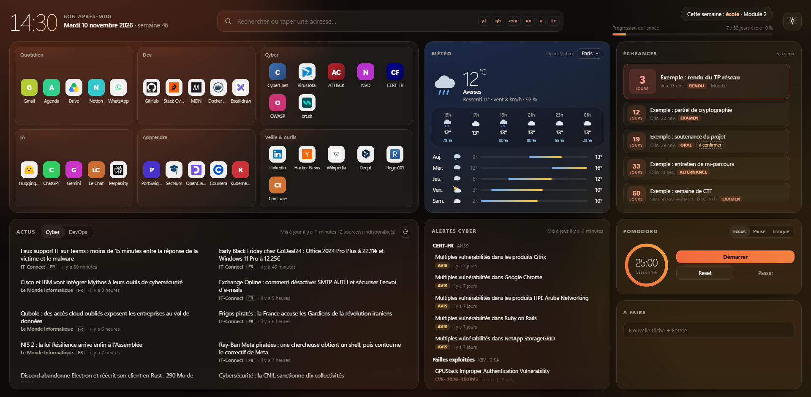
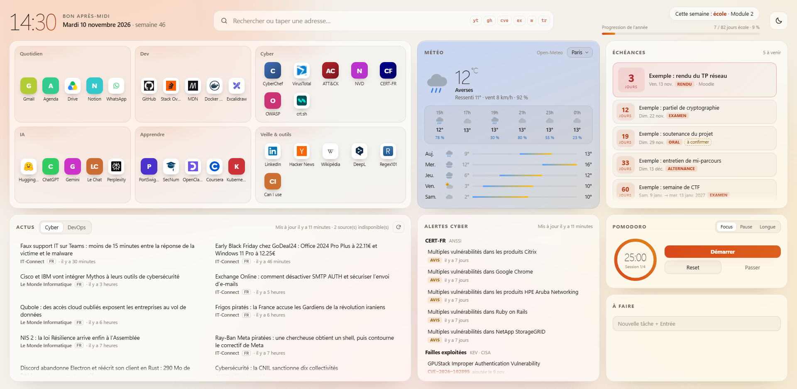

# Bento New Tab

Page de nouvel onglet pour Firefox, en grille « bento » qui tient dans l'écran : raccourcis, météo, échéances, actus cyber et DevOps, alertes de sécurité, Pomodoro et to-do. Thème clair et sombre.

Pensée pour les étudiants et alternants en informatique / cybersécurité, mais tout se configure dans un seul fichier.

Thème clair

> *English summary below.*

## Fonctionnalités

| Tuile | Ce qu'elle fait |
|---|---|
| Raccourcis | Sites groupés par thème, icône de chaque site (ou pastille avec l'initiale) |
| Recherche | Google par défaut ; raccourcis `yt`, `gh`, `cve`, `ex`, `w`, `tr` (ex. `cve log4j`) ; `/` pour placer le curseur |
| Météo | Conditions actuelles, prochaines heures, 5 jours (Open-Meteo, sans clé) ; ville modifiable d'un clic |
| Échéances | Compte à rebours, prochaine échéance mise en avant, mention « à confirmer » |
| Actus | Onglets Cyber et DevOps à partir de flux RSS publics (FR et EN) |
| Alertes | Derniers avis et alertes du CERT-FR, dernières failles du catalogue KEV de la CISA |
| Pomodoro | 25 / 5 / 15 min, notification en fin de session même onglet fermé |
| À faire | Liste de tâches partagée entre les onglets |
| Alternance | Semaine école ou entreprise et progression de l'année (facultatif) |

Le bouton soleil/lune bascule entre les thèmes. Sans choix enregistré, la page suit le réglage clair/sombre du système.

## Installation

### Essayer (jusqu'au redémarrage de Firefox)
1. Télécharger le dépôt (`git clone` ou bouton **Code → Download ZIP**).
2. Ouvrir `about:debugging#/runtime/this-firefox`.
3. **Charger un module complémentaire temporaire…** et choisir `manifest.json`.

### Installer pour de bon
Firefox n'installe que des extensions signées. La signature « pour soi » est gratuite et automatique, l'extension n'est pas publiée :
1. Changer l'`id` dans `manifest.json` (`browser_specific_settings.gecko.id`), il doit être unique sur addons.mozilla.org.
2. Fabriquer le zip : `git archive --format=zip -o ../bento-newtab.zip HEAD`.
3. Sur [addons.mozilla.org/developers](https://addons.mozilla.org/developers/), **Soumettre une nouvelle extension → Sur votre propre site**, envoyer le zip.
4. Télécharger le `.xpi` signé et le glisser dans Firefox.

## Personnalisation

Tout se règle dans un seul fichier, sans modifier le code :

1. Copier `js/config.js` en `js/config.local.js`. Ce fichier est ignoré par Git : vos liens et vos dates restent chez vous.
2. Modifier la copie. Elle remplace la configuration de démonstration au chargement.

| Clé | Rôle |
|---|---|
| `groups` | Groupes de raccourcis : `name`, `url`, et au choix `icon`, `favicon`, `color`, `title` |
| `favicons` | `true` : icône chargée depuis chaque site ; `false` : aucune requête, pastilles ou icônes locales |
| `bangs`, `search` | Moteur de recherche et raccourcis de recherche |
| `weatherDefault` | Ville affichée par défaut |
| `feeds`, `certfr`, `kev` | Sources d'actus et d'alertes |
| `deadlines` | Échéances : `date`, `end`, `title`, `tag`, `where`, `unsure`, `note` |
| `schoolWeeks`, `company`, `holidays` | Calendrier d'alternance (laisser `schoolWeeks: []` pour masquer) |
| `labels` | Titres des tuiles Échéances et Progression |

- **Icônes locales** : déposer l'image dans `img/sites/` (dossier ignoré par Git) et l'indiquer avec `icon: 'mon-site.png'`.
- **Nouvelle source d'actus** : ajouter aussi son domaine dans `permissions` de `manifest.json`. Utiliser l'adresse finale du flux, sans redirection vers un autre domaine.
- **Couleurs** : toutes les couleurs des deux thèmes sont des variables en tête de `css/style.css`.

## Données et vie privée

- Aucune statistique, aucun pistage, aucun compte.
- Tâches, minuteur, ville et cache des actus restent dans le stockage local de Firefox.
- Requêtes réseau :
  - [Open-Meteo](https://open-meteo.com/) pour la météo (coordonnées de la ville choisie) ;
  - les flux RSS et le catalogue KEV listés dans la configuration ;
  - avec `favicons: true`, chaque site des raccourcis, pour son icône.

## Sécurité

- Aucune donnée externe n'est insérée en HTML : titres des flux et réponses des API passent par `textContent`.
- Les liens issus des flux sont filtrés (`http` et `https` uniquement).
- Les permissions se limitent aux domaines des sources listées dans `manifest.json`.

## Crédits

- Météo : [Open-Meteo.com](https://open-meteo.com/), données sous licence CC BY 4.0.
- Alertes : [CERT-FR](https://cert.cyber.gouv.fr/) (ANSSI) et [CISA Known Exploited Vulnerabilities](https://www.cisa.gov/known-exploited-vulnerabilities-catalog).
- Les articles et les icônes de sites appartiennent à leurs éditeurs respectifs.

## Licence

[MIT](LICENSE)

---

## English summary

**Bento New Tab** is a Firefox new-tab page laid out as a full-screen bento grid: shortcuts with live site icons, weather (Open-Meteo, no API key), deadline countdowns, cyber and DevOps news from public RSS feeds, CERT-FR advisories and CISA KEV entries, a Pomodoro timer with notifications, a to-do list and an optional work-study (alternance) calendar. Light and dark themes with a toggle.

- **Try it**: `about:debugging#/runtime/this-firefox` → *Load Temporary Add-on…* → `manifest.json`.
- **Customize**: copy `js/config.js` to `js/config.local.js` (git-ignored) and edit it.
- **Privacy**: no tracking; data stays in Firefox local storage; network calls only to Open-Meteo, the listed feeds and, if `favicons: true`, the shortcut sites.
- The interface is in French.

MIT licensed.
